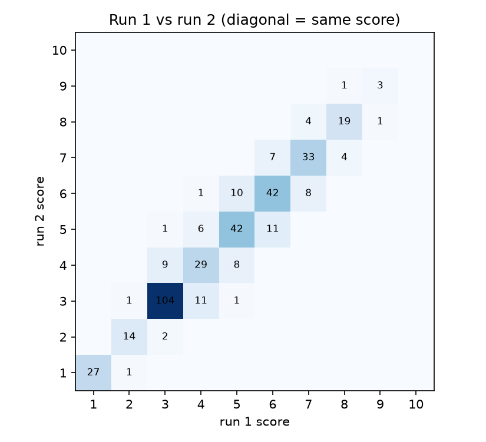
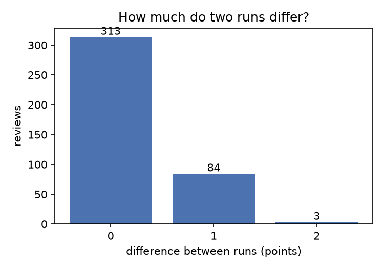
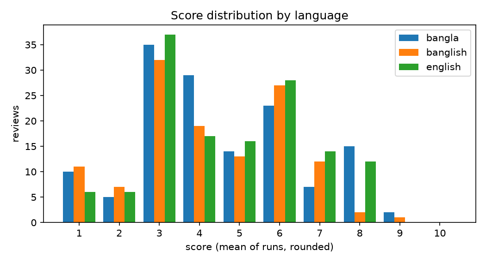

# Main run: Gemini review-quality scoring

This folder holds the main run of the review quality evaluator. The evaluator gives a review a score
from 1 to 10 for how useful it would be to a buyer. The pilot (`pilot/README.md`) tested two prompt
versions on 100 reviews and chose `prompt_v2`. The main run uses that frozen prompt on a new sample
of 400 reviews and then checks the scores against human judgment, which is the first step set by the
course instructor: is a review scored 8 really better than one scored 5?

The main sample does not contain any pilot review, because the prompt was adjusted after reading the
pilot results. The pilot reviews were therefore not a fair test of the final prompt.

| | Pilot (100 reviews) | Main run (400 reviews) |
|---|---|---|
| Question | Does the prompt work: does it run cleanly, give stable scores and use the scale sensibly? | Does the score reflect quality: is a review scored 8 really better than one scored 5? |
| Checks | Stability between two runs; score distribution; manual read of scored reviews; v1 against v2 | Blind pair check by two raters; length and language bias; stability again on a larger sample |
| Prompt | `prompt_v1.txt` and `prompt_v2.txt` | Frozen: `prompt_v2.txt` |
| Folder | `pilot/` | `main/` |
| Scripts | 01, 03, 04, 07 | 02, 03, 04, 05, 05b, 06, 07 |
| State | Done | Done: 400 reviews scored twice, 24 blind pairs checked by two raters |

The reviews come from `trend_analysis/data/reviews_all.csv` of the `ai-review-trends` project
(Daraz, Rokomari and Shajgoj; Bangla, Banglish and English). Run all commands from the
`quality_eval` folder, one level above this one. The prompt, what was wrong with v1 and what v2
changed are described in `pilot/README.md` and are not repeated here.

## Design

| Choice | Setting |
|---|---|
| Judge | Gemini `gemini-3.5-flash-lite`, temperature 0, JSON output (same as the pilot) |
| Input to the judge | Product name and review text only. Star rating, platform, date and language are not sent |
| Output | `reason` (one sentence), then `overall` (integer 1–10) |
| Prompt | `prompts/prompt_v2.txt`, frozen before the run and not changed afterwards |
| Runs | Two runs of the same prompt on every review, to measure stability (800 scores) |
| Sample | 400 reviews, seed 42, drawn without the 100 pilot reviews |
| Human check | Blind pairs: one high-scored and one middle-scored review per pair; two raters each choose the more useful review. The raters never see the scores |

Decisions made while planning the human check:

- **Pairs instead of single scores.** Raters differ in how strict they are, so asking for a 1–10
  score adds noise. Choosing the better of two reviews is easier and more reliable, and it answers
  the instructor's question directly (is 8 better than 5?). The single-score sheet from the first
  plan was dropped.
- **High against middle, not high against low.** A high-scored review (mean 8 or more) is paired
  with a middle-scored one (mean 4–6) of the same platform and language. Pairing against a clearly
  bad review would be too easy to pass.
- **Same platform and language inside a pair.** Raters then compare like with like and cannot use
  the platform or the language as a clue.
- **Two raters, each with their own copy.** Each rater gets the same HTML page and answers on their own page.
  This also measures how much the raters agree with each other.
- **A "Can't decide" button.** Forced choices on near-equal pairs would add noise. Such answers are
  left out of the counts.

## Main sample

`data/main_sample.csv` has 400 reviews drawn from the reviews the earlier pipeline kept (at least 6
words, no exact repeats), without the pilot reviews. The sampler aims for equal shares per length
range, spread over language and platform. The 50+ range has fewer reviews than the others because
some language and platform groups hold few long reviews (for example, only 20 Banglish reviews have
50 or more words); the shortfall was filled with random reviews.

| Length (words) | Reviews | | Language | Reviews | | Platform | Reviews |
|---|---|---|---|---|---|---|---|
| 6–9 | 100 | | Bangla | 140 | | Shajgoj | 138 |
| 10–19 | 109 | | Banglish | 124 | | Daraz | 132 |
| 20–49 | 104 | | English | 136 | | Rokomari | 130 |
| 50+ | 87 | | | | | | |

As in the pilot, the sample is balanced by length, so long reviews are over-represented compared with
the full dataset. The score distribution below describes this sample and not all reviews.

22 of the 400 reviews (all from Rokomari, 51 to 694 words) end with the words "Read More". This is
leftover text from the website, where long reviews are cut off with that link, and the review may
be cut short at that point. Gemini and the raters saw exactly the same text, so the comparison is
fair, but the reviews are not fully clean.

## How to run

```powershell
$env:GEMINI_API_KEY = "<key>"                          # never commit API keys

python scripts\02_make_main_sample.py                  # once; do not run again after scoring
python scripts\03_score.py --folder main --runs 2 --prompt prompt_v2.txt     # about 1 hour, resumable
python scripts\04_summarize.py --folder main --version prompt_v2
python scripts\07_make_page.py --folder main           # optional: readable page of the scored reviews
python scripts\05_make_check_sheets.py                 # blind pairs and answer key
python scripts\05b_make_pair_page.py                   # pair_page.html for the raters
# send main\results\pair_page.html to each rater
# save each pairs_filled_<name>.csv they return in main\results\
python scripts\06_check_results.py                     # compare raters with the Gemini scores
```

Notes:

- Set the key in the same PowerShell window that runs the scoring.
- Always pass `--prompt prompt_v2.txt` to step 03. The default in the script is still
  `prompt_v1.txt`, so leaving it out would score with the wrong prompt.
- If scoring stops (quota, network), run the same command again. It skips every review, run and
  prompt version already in `scores_raw.csv`. Use a key from a different Google project if the daily
  quota is used up; keys from the same project share one quota.
- If step 05 is run again, run step 05b again too, and collect new answers. An old page no longer
  matches the new `pairs_key.csv`.
- Do not leave extra or test files named `pairs_filled...` in `main\results\`. Every such file is
  counted as a rater.

## Scripts

The shared scripts (01 to 04 and 07) are described in `pilot/README.md`. The three scripts used only
in the human check are:

### `05_make_check_sheets.py`

```powershell
python scripts\05_make_check_sheets.py
python scripts\05_make_check_sheets.py --pairs 50 --high-min 7
```

| Option | Default | Meaning |
|---|---|---|
| `--pairs` | 50 | Number of pairs wanted. Fewer are made if there are not enough high-scored reviews |
| `--high-min` | 8 | Lowest mean score counted as "high". Lowering it gives more pairs, but the difference between the two reviews in a pair becomes smaller |

For each high-scored review the script picks one middle-scored review (mean 4–6) of the same platform
and language, and puts the two in random A/B order. It uses only the latest prompt version in
`scores_raw.csv`. It writes `pairs_for_raters.csv` (no scores, for the raters) and `pairs_key.csv`
(with scores and word counts; never given to raters).

### `05b_make_pair_page.py`

```powershell
python scripts\05b_make_pair_page.py
```

Reads `pairs_for_raters.csv` and writes `pair_page.html`, one self-contained file with no scores in
it. The rater opens it in a browser, types a name, and sees one pair at a time with the buttons "A is
more useful", "B is more useful" and "Can't decide", plus Back to change an answer. Progress is saved
in the browser, so a rater can close the page and continue. At the end a button downloads
`pairs_filled_<name>.csv` (columns `pair_id`, `better_AorB`, `rater`) to the rater's Downloads
folder; it must be moved to `main\results\`.

### `06_check_results.py`

```powershell
python scripts\06_check_results.py
```

Reads every `pairs_filled*.csv` in `main\results\` and `pairs_key.csv`. It reports, for each rater and
for all raters together, how often the rater picked the review Gemini scored higher, with a 95%
interval, split by whether the higher-scored review was the longer one. It also reports how often
two raters chose the same review (with Cohen's kappa) and, for the pairs where all raters agreed,
how often Gemini agrees with them. "Can't decide" and blank answers are left out. The output is
printed and saved as `check_summary.txt`. The combined interval counts each answer separately, but
both raters answer the same pairs, so it is too narrow; the per-rater numbers are the safer ones.

## Files

| Path | Contents |
|---|---|
| `data/main_sample.csv` | The 400 main reviews: `review_id`, `platform`, `language`, `n_words`, `product_name`, `text_original` |
| `results/scores_raw.csv` | One row per review and run: `review_id`, `run`, `overall`, `reason`, `model`, `prompt_version`. Only ever appended to |
| `results/scores_wide.csv` | One row per review: `run1`, `run2`, `mean` (the final score), `spread`, `reason_run1`, and the sample columns. Rebuilt by step 04 |
| `results/stability_summary.txt` | Run counts, stability, score spread, mean score by language and length |
| `results/review_page.html` | Readable page of all scored reviews, built by step 07 |
| `results/fig_differences.png` | How many reviews differ by 0, 1, 2 points between the two runs |
| `results/fig_run1_vs_run2.png` | Grid of run 1 against run 2 scores; the diagonal means the same score |
| `results/fig_score_distribution.png` | Number of reviews per score, by language |
| `results/pairs_for_raters.csv` | The 24 pairs without scores, built by step 05 |
| `results/pairs_key.csv` | The same pairs with Gemini's scores and word counts. Keep away from raters |
| `results/pair_page.html` | The click-through page for the raters, built by step 05b |
| `results/pairs_filled_<name>.csv` | One file per rater with their A/B answers |
| `results/check_summary.txt` | Output of step 06 |

## Results

Model `gemini-3.5-flash-lite`, prompt `prompt_v2`, two runs on 400 reviews. 800 scores were requested
and 800 received; every review has a score in both runs and none is missing.

### Stability

| Measure | Pilot (v2, 100 reviews) | Main (400 reviews) |
|---|---|---|
| Same score in both runs | 79% | 78% |
| Within 1 point | 99% | 99% |
| Differ by 2 or more points | 1% | 1% (3 reviews) |
| Rank correlation, run 1 against run 2 | 0.97 | 0.96 |

The planned target was at least 85–90% of reviews within 1 point. The main run is well above it and
almost the same as the pilot. Of the 400 reviews, 313 got the same score twice, 84 differed by one
point and 3 by two points (scores 5 and 3, 4 and 6, 3 and 5). The three larger differences are a
16-word Shajgoj review and two Rokomari reviews of 21 and 38 words.





### Score distribution (mean of the two runs, rounded)

| Band | Pilot (v2) | Main |
|---|---|---|
| 1–2 | 9% | 11% |
| 3–4 | 43% | 42% |
| 5–6 | 24% | 30% |
| 7–8 | 22% | 16% |
| 9–10 | 2% | 1% |
| Mean score | 4.77 | 4.50 |

Nine different scores are used, as in the pilot. Reviews with a mean of 2 or less number 42, with
a mean of 3 or less 149, with a mean between 4 and 6 151, with a mean of 7 or more 65, and with a mean
of 8 or more 24. No review scores 10 in either run and the highest mean is 9. The shape matches the
pilot: the largest band is 3–4, which fits a sample with many generic reviews, and the top of the
scale is used rarely. The slightly lower mean (4.50 against 4.77) is within what a different sample
of 100 and 400 reviews would give.



### By language, platform and length

| Language | Reviews | Mean score | | Platform | Reviews | Mean score | | Length (words) | Reviews | Mean score |
|---|---|---|---|---|---|---|---|---|---|---|
| Bangla | 140 | 4.54 | | Daraz | 132 | 4.82 | | 6–9 | 100 | 3.10 |
| Banglish | 124 | 4.25 | | Rokomari | 130 | 4.18 | | 10–19 | 109 | 3.85 |
| English | 136 | 4.69 | | Shajgoj | 138 | 4.50 | | 20–49 | 104 | 5.01 |
| | | | | | | | | 50+ | 87 | 6.30 |

- **Language.** Banglish has the lowest mean (4.25) and English the highest (4.69), a gap of 0.44
  points (0.15 in the pilot). Part of this is a difference in length: only 20 Banglish reviews have
  50 or more words, against 34 Bangla and 33 English, and long reviews score higher. Inside the
  length ranges the gap is smaller. In the 50+ range Banglish scores 6.42 against 6.09 for Bangla and
  6.45 for English. In the 6–9 and 20–49 ranges Banglish is about 0.25–0.35 points lower (2.88
  against 3.21 and 3.23, and 4.84 against 5.08 and 5.10), and in the 10–19 range it equals Bangla
  (3.76) and is 0.28 below English.
  With 20–37 reviews per cell these differences are within noise, but they are worth watching.
  The top of the scale shows the same direction: 24 reviews have a mean of 8 or more, and only 2 of
  them are Banglish (14 Bangla, 8 English); proportionally about 7 would be expected. This should be
  checked on the review page: are good Banglish reviews being scored 6–7 instead of 8?
- **Platform.** Rokomari (books) has the lowest mean (4.18) and only 10 reviews with a mean of 7 or
  more, against 21 for Daraz and 34 for Shajgoj. Many Rokomari reviews retell the plot or copy a
  blurb, which the prompt scores low, so a lower mean is expected, but it also means the book rules
  of the prompt matter for this platform. Of the 14 reviews with 50 or more words and a mean of 4 or
  less, 9 are from Rokomari.
- **Length.** Score and word count have a rank correlation of 0.62 (0.68 in the pilot). Longer
  reviews have more room for detail, so some correlation is expected. Length alone does not decide
  the score: 14 of the 87 reviews with 50 or more words scored 4 or below (1 of 26 in the pilot),
  and the reasons show why: generic praise, a question to the seller, a discount-group advertisement,
  a copied blurb or quoted passage. At the other end, 24 reviews of 22 words or fewer scored 6 or
  more because they contain concrete detail.

### Human check: blind pairs

**How it was done.** Step 05 found 24 reviews with a mean of 8 or more (19 at 8, two at 8.5, three
at 9) and paired each with a middle-scored review (mean 4 to 6) of the same platform and language,
giving 24 pairs (the target was 50, but only 24 reviews reached 8). The 24 high-scored reviews are
14 Bangla, 8 English and 2 Banglish, and the 48 reviews in the pairs come from Shajgoj (26), Daraz
(14) and Rokomari (8). Two raters (Fahima_Afrin_Anuva and Tazrian) opened the same page, saw no
scores, and chose the review that would help a buyer decide more. Nobody used "Can't decide".

| Measure | Fahima_Afrin_Anuva | Tazrian | Both together |
|---|---|---|---|
| Picked the review Gemini scored higher | 21/24 = 88% (95% CI 69–96%) | 23/24 = 96% (95% CI 80–99%) | 44/48 = 92% (95% CI 80–97%) |
| When the higher-scored review is the longer one | 19/21 = 90% | 21/21 = 100% | 40/42 = 95% |
| When the higher-scored review is the shorter one | 2/3 | 2/3 | 4/6 |

| Agreement between the raters | |
|---|---|
| Same choice on the same pair | 22/24 = 92% |
| Cohen's kappa | 0.83 (strong agreement) |
| Pairs where both raters chose the same review: Gemini agrees | 21/22 = 95% |

For a score that carried no information, about half of the answers would match. The lowest end of
each rater's interval (69% and 80%) is well above that, and the two raters agree with each other
almost as often as they agree with Gemini, so the check itself is reliable.

**The length problem.** In 21 of the 24 pairs the higher-scored review is also the longer one (the
median ratio is 3.8 times longer). A rule that always picks the longer review would agree with Gemini on
21 of 24 pairs, which is 88%, the same as the first rater. So the 88–96% alone cannot show that
people agree with Gemini because of quality and not because of length. Only the three pairs in which
the higher-scored review is shorter can separate the two, and they point both ways:

- Pair 9: a 51-word review of a sunscreen (score 8.0, personal use, a specific problem with sweat and
  tanning) against a 62-word, mostly praise review of a rose water mist (4.5). Both raters chose
  the shorter, higher-scored review.
- Pair 23: a 57-word review of earbuds with ratings for sound, calls and fit and the price paid (8.0)
  against a 150-word review that complains about delivery charges and the coupon system of the shop
  (5.0). Both raters chose the shorter, higher-scored review.
- Pair 24: a 182-word review of a mystery novel (the second book of a series) with the reviewer's own
  assessment of plot structure, pacing, strengths and weaknesses (8.0) against a 321-word review of
  a Humayun Ahmed Himu book that starts with the book's data (author, pages, price, publisher) and a
  long plot description plus some personal reflection (5.5). Both raters chose the longer review.

In pairs 9 and 23 both raters went against the longer review and with Gemini, which shows they
are not just picking the longer one. Three pairs are too few for a firm conclusion.

**Where people and Gemini disagree.** Of the 48 answers, 4 differ from Gemini: both raters on pair 24
(above) and one rater on each of two other pairs.

- Pair 6: Gemini gave 8.0 to a 40-word review of a body wash that mentions price, quantity,
  fragrance, delivery outside Dhaka, packaging and a free gift, and 5.0 to a 13-word eye cream review
  about a reduction of dark circles. One rater preferred the eye cream review, apparently valuing a
  personal result more than service details.
- Pair 19: Gemini gave 8.0 to a review of a niacinamide serum used for a month with a concrete acne
  result and 6.0 to a review warning that a rose water mist did not suit dry skin. One rater
  preferred the warning.

Pair 24 is the one clear disagreement and it is a book review. The prompt says a review that
mainly retells the plot should not score above 5. Gemini scored this one 5.5, and both raters found it
more useful. This is the same book-rule weakness seen in the pilot: the plot cap is not applied
cleanly, and in this case a human may judge such a review more generously than the prompt does.

## Is the evaluator validated?

Mostly yes, with two limits. On the main sample the scores are as stable as in the pilot (99% within
1 point, rank correlation 0.96), the scale is used in a similar way, and in a blind check two raters
chose the review Gemini scored higher in 88% and 96% of 24 pairs, agreeing with each other on 92%
(kappa 0.83). The first limit is length, which the check cannot rule out, as described above. The
second is coverage: the check compares only top against middle reviews, so it shows that an 8 is
better than a 5 but says nothing about the low end of the scale or about small steps such as 6 against
7. The honest wording for a report is: "In a blind check, two raters preferred the higher-scored
review in 88–96% of 24 pairs (kappa 0.83); in 21 of the 24 pairs it was also the longer review, so a
length effect is not excluded."

## Limitations

- 24 pairs and two raters give wide intervals (for one rater, 69–96% and 80–99%). The pair count was
  limited because only 24 of the 400 reviews reached a mean of 8.
- 21 of 24 pairs have the higher-scored review as the longer one, so length is not separated from
  quality. Only 3 pairs test that, and two of them agree with Gemini and one does not.
- The pairs hold only 2 high-scored Banglish reviews (4 of 48 reviews), so the check says little about
  Banglish. Banglish also has the lowest mean score, and the gap is not explained by the check.
- The pairs compare top against middle only. The low end and the steps between neighbouring scores
  are not tested by humans.
- Both raters judged the same pairs, so the combined interval is too narrow; the per-rater numbers
  are the safer ones.
- Only one model and temperature 0 were used. A second model was not compared. The book rules of
  the prompt (plot-retelling cap) are not followed reliably by this small model.
- 22 Rokomari reviews end with a scraped "Read More" and may be cut off.
- Only the text and the product name are scored. A review cannot be checked for truth, copied text
  or fake detail.
- The sample is balanced by length, so score shares do not describe the full dataset.

## Status

| Item | State |
|---|---|
| Main sample of 400 reviews drawn without the pilot reviews | Done |
| 400 reviews scored twice with `prompt_v2`, summary and figures built | Done (800 scores, none missing) |
| Stability check | Passed (99% within 1 point, rank correlation 0.96) |
| Blind pair check by two raters (24 pairs) | Done (88% and 96% agreement with Gemini, kappa between raters 0.83) |
| Length bias | Not ruled out (21 of 24 higher-scored reviews are longer) |
| Language bias | Banglish mean lower by 0.3–0.4; partly explained by length; not tested by raters |

## Next steps

1. Optional: open `results/review_page.html` and read the Banglish reviews scored 6–7, to see whether
   some deserve an 8, and the long Rokomari reviews, to see how the book rules were applied.
2. Optional, to settle the length question: build a few more pairs in which the higher-scored review
   is the shorter one (or the same length), have the same two raters choose again, and run step 06.
   This needs a small change to step 05 (a filter on word count).
3. Write the results into the project report with the wording above, including the length caveat
   and the language note.
4. After the evaluator is validated: suggestions to the writer for improving a review, and a check
   that the score rises when a review is improved.
