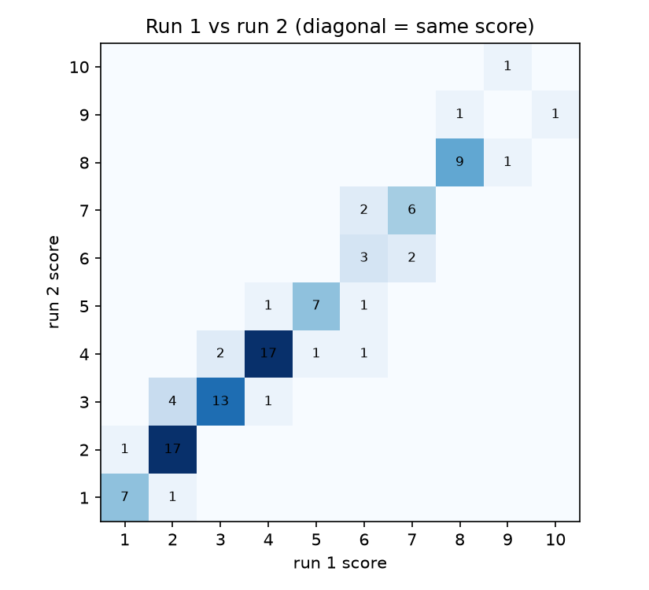
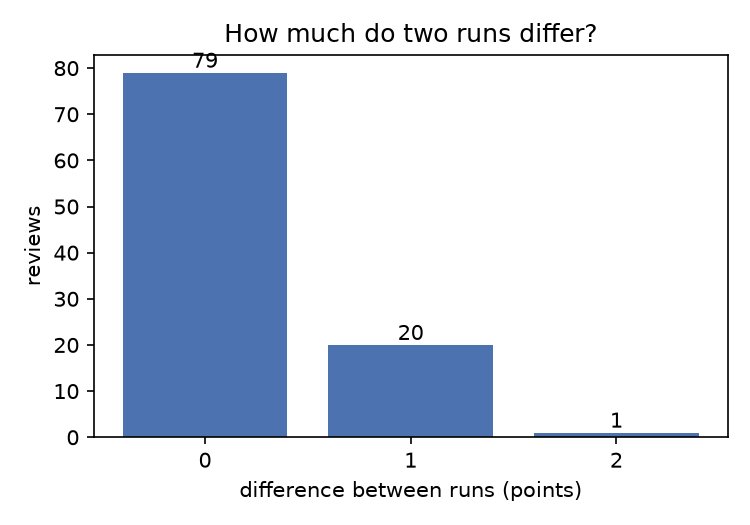
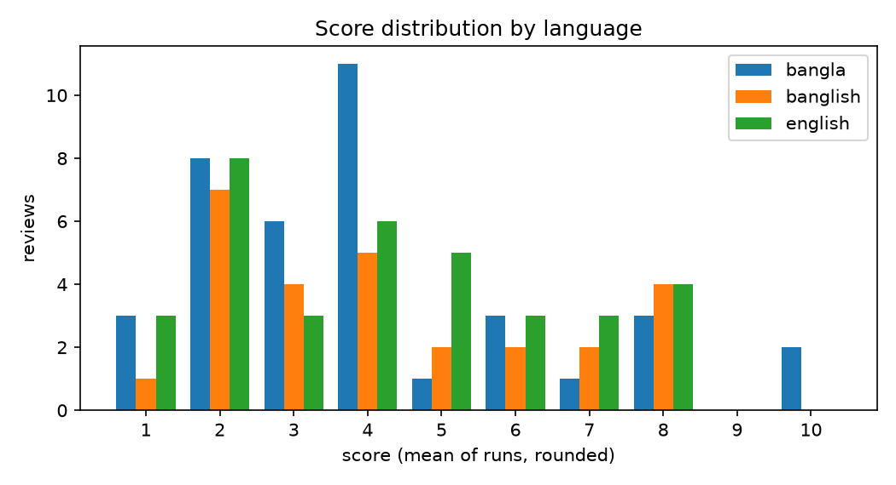

# Pilot: Gemini review-quality scoring

This folder holds the pilot of the review quality evaluator. The evaluator gives a review a score from
1 to 10 for how useful it would be to a buyer. The first step, set by the course instructor, is to
let an LLM (Gemini) score a sample of reviews and then check whether the reviews it scores higher
(for example 8) are really better than the ones it scores lower (for example 5).

The pilot is a dry run of that step on 100 reviews. It tests whether the prompt works, whether the
scores are stable from one run to the next, and whether the score distribution is sensible, before
the prompt is frozen and used on the 400-review main sample. The pilot reviews are not used in the
main sample or in the final human check, because the prompt may be adjusted after the pilot.

The pilot has now been run with two prompt versions on the same 100 reviews: `prompt_v1` (first
version) and `prompt_v2` (revised after reading the v1 results). This README describes both, what
was wrong with v1, what v2 changed, and how the two compare.

| | Pilot (100 reviews) | Main run (400 reviews) |
|---|---|---|
| Question | Does the prompt work: does it run cleanly, give stable scores and use the scale sensibly? | Does the score reflect quality: is a review scored 8 really better than one scored 5? |
| Checks | Stability between two runs; score distribution; manual read of about 30 scored reviews; v1 against v2 | Blind human check (pairs and single scores); length and language bias; stability again on a larger sample |
| Prompt | `prompt_v1.txt` and `prompt_v2.txt`; v2 is the candidate for freezing | Frozen; the final pilot version (planned: `prompt_v2.txt`) |
| Folder | `pilot/` | `main/` |
| Scripts | 01, 03, 04, 07 | 02, 03, 04, 05, 06, 07 |
| State | Scored with v1 and v2; stability passed for both; manual read of v2 pending | Not started |

The reviews come from `trend_analysis/data/reviews_all.csv` of the `ai-review-trends` project
(Daraz, Rokomari and Shajgoj; Bangla, Banglish and English). Run all commands from the
`quality_eval` folder, one level above this one.

## Design

| Choice | Setting |
|---|---|
| Judge | Gemini `gemini-3.5-flash-lite`, temperature 0, JSON output |
| Input to the judge | Product name and review text only. Star rating, platform, date and language are not sent, so the score reflects the text and not the sentiment |
| Output | `reason` (one sentence), then `overall` (integer 1–10) |
| Prompt | `prompts/prompt_v1.txt` (first version) and `prompts/prompt_v2.txt` (revised). Criteria for good and bad reviews and a 1–10 scale. No worked examples, no list of expected aspects per product type |
| Strictness | Generic praise or complaint with no detail should not score above 3 |
| Runs | Two runs of the same prompt on every review, to measure stability |
| Sample | 100 reviews, kept apart from the main sample by saving their IDs. The same 100 reviews were used for v1 and v2, so the two versions can be compared review by review |

Decisions made while planning:

- **No examples in the prompt.** Examples can bias a model towards their wording and scores. They
  are added only if the pilot shows a badly used scale.
- **No fixed aspect lists.** The judge works out what matters for the product from its name. A fixed
  list per product type would reward reviews that mention the listed words and would not work on
  other platforms.
- **No sub-scores.** An earlier version also returned specificity, experience, reasoning and
  relevance scores; they were dropped to keep the output simple. The `reason` column is kept for
  diagnosing individual scores.
- **Writer feedback is left for later.** Tips for the review writer are not part of this stage; the
  question here is only whether the score reflects quality.
- **Score the information, not whether the review is real.** The evaluator does not try to detect
  fake or AI-written reviews (that is the separate trend analysis). Polished or promotional wording
  is not penalised; only the information in the review counts.

## What was wrong in v1

v1 passed the stability check (99% within 1 point), so the problems were not about repeatability.
They came from reading the scored sheet and the reasons:

| Problem in v1 | Evidence in the pilot |
|---|---|
| **Delivery and service information was treated as worthless.** The prompt listed "a delivery-only complaint" as off-topic, so reviews with concrete delivery, packaging or authenticity information were pushed to 1–2 | 30% of reviews were in the 1–2 band and 22 reviews had a mean of 2 or lower. Examples: a review saying the product arrived damaged and looked opened and re-stickered scored 2; a review about the Daraz-to-Shajgoj price mismatch scored 1.5. Buyers in Bangladesh rely on exactly this information |
| **Too much weight on the physical book.** Reasons for book reviews kept saying "lacks specific details about the physical book quality", although the prompt is about the reader's experience | Personal reviews of Misir Ali and Zahir Raihan books scored 4 mainly because they did not discuss binding or print |
| **Book plot summaries scored too high.** The prompt called copied blurbs bad, but not plot retelling | Three *Kite Runner* reviews that mostly retell the plot or the history scored 7, 6.5 and 6 |
| **Generic advice and mid-scale offsets.** Claims not tied to the reviewer's own use were not named as weak; a 5 and a 7 were not clearly different | Review 2675436 (tip to be patient, no personal use) scored 4; review 14808 (18 words, "Best for dry skin. I like its smell…") scored 7 |
| **Scale anchors were vague.** "5–6: some detail, but thin" and "7–8: clearly specific and personal" left room for different readings, and the scale was piled at the bottom (30% in 1–2) | Distribution: 1–2: 30%, 3–4: 35%, 5–6: 16%, 7–8: 17%, 9–10: 2% |
| **Risk of judging whether the review is real.** Nothing told the judge to ignore polished or promotional wording, or not to guess at fake reviews | Not seen as a problem in the pilot, but it would confuse the later AI-share analysis |
| **Risk of reading in missing context.** The judge could assume the reviewer tested something | Several reasons read generously ("making it very useful") for short reviews |

## What v2 changed

| Change in `prompt_v2.txt` | Reason |
|---|---|
| Judge usefulness for "this product **from this shop**" | The buying experience belongs to the shop, not only the product |
| New section **WHAT COUNTS AS USEFUL DETAIL**: product details, and the buying experience (delivery time, condition on arrival, packaging, original or genuine, match with photos, how the seller handled a problem). "Specific means checkable": "arrived in 2 days, box sealed" counts, "fast delivery" alone does not | Fixes the delivery and authenticity problem |
| A review that is **only** about delivery or service cannot score above 6 | Keeps service-only reviews below real product reviews |
| New section **BOOKS**: judge the reviewer's own reading experience; do not lower the score because binding, paper or print are not discussed; plot or background retelling with little opinion cannot score above 5 | Fixes the physical-book and plot-summary problems |
| "Score only what the review actually says"; do not assume testing, duration or results; a one-word claim ("original", "as described") is a small piece of information | Stops generous readings of short reviews |
| Do not reward emotional or enthusiastic language by itself; mixed reviews are not penalised | Score the information, not the tone |
| Do not decide whether a review is genuine, fake or AI-generated; do not lower the score for polished, promotional or machine-written text | Keeps the evaluator separate from the AI-share analysis |
| Bad reviews now also include "a request to the shop (restock, price, offers)", "only advertising copy" and "general advice or claims not tied to the reviewer's own use"; "fast delivery" added to the stock phrases | Closes the off-topic and generic-advice gaps |
| Scale rewritten with one anchor per score from 1 to 10 (for example 5: one specific detail with little explanation; 7: specific detail backed by the reviewer's own use or purchase; 8: several useful details or real depth on one point). "A 10 should be rare" | Gives each score a distinct meaning and reduces the pile-up at the bottom |
| Strictness line now covers "generic praise or complaint with no detail, about the product **or the delivery**" | Generic delivery praise stays at 3 or below |

## The prompt

The judge is told to assess how useful the review would be to a person deciding whether to buy the
product from this shop, and not to judge sentiment, spelling, grammar, language or script, or
length or enthusiasm by itself.

| Good review | Bad review |
|---|---|
| Specific: names concrete features, results or service details | Only generic adjectives or stock phrases ("nice product", "recommended", "fast delivery") |
| Personal: real use or a real purchase, how long, in what situation | Nothing a buyer could check or act on |
| Reasoned: a reason, a pro and a con, or a comparison | Off-topic: question to the seller, request to the shop (restock, price, offers), spam |
| Relevant: useful to someone deciding whether to buy from this shop | Copied product description or book blurb, or advertising copy, with no opinion of the reviewer's own; general advice not tied to the reviewer's own use |

| Score (v2) | Meaning |
|---|---|
| 1 | Empty, meaningless, spam or off-topic |
| 2 | Almost nothing a buyer could use |
| 3 | Generic praise or complaint, no detail |
| 4 | A hint of information, but no concrete detail |
| 5 | One specific detail, with little explanation |
| 6 | Specific detail about the product or the buying experience, with limited context |
| 7 | Specific detail backed by the reviewer's own use or purchase |
| 8 | Several useful details, or real depth on one point |
| 9 | Detailed, personal and reasoned, strongly useful to a buyer |
| 10 | Exceptionally informative, thorough and balanced (rare) |

(v1 used five bands: 1–2, 3–4, 5–6, 7–8, 9–10.)

## Pilot sample

`data/pilot_sample.csv` has 100 reviews drawn from the reviews the earlier pipeline kept (at least 6
words, no exact repeats), with seed 7. Reviews are spread evenly over four length ranges, and within
each range over language and platform, so that short generic reviews do not dominate.

| Length (words) | Reviews | | Language | Reviews | | Platform | Reviews |
|---|---|---|---|---|---|---|---|
| 6–9 | 24 | | Bangla | 38 | | Daraz | 41 |
| 10–19 | 25 | | English | 35 | | Shajgoj | 33 |
| 20–49 | 25 | | Banglish | 27 | | Rokomari | 26 |
| 50+ | 26 | | | | | | |

Because the sample is balanced by length, long reviews are over-represented compared with the full
dataset (26% here against a much smaller share overall). The score distribution below therefore
describes this sample and not all reviews.

## How to run

```powershell
python -m pip install google-genai pandas matplotlib
$env:GEMINI_API_KEY = "<key>"                          # never commit API keys

python scripts\01_make_pilot_sample.py                  # already done; the sample is in pilot\data
python scripts\03_score.py --folder pilot --runs 2 --prompt prompt_v2.txt   # about 15 minutes, resumable
python scripts\04_summarize.py --folder pilot --version prompt_v2           # table, summary and figures
python scripts\07_make_page.py                         # readable page of all reviews, for the manual read
```

Set the key in the same PowerShell window that runs the scoring. `set GEMINI_API_KEY=...` is
Command Prompt syntax and does not work in PowerShell.

Step 01 is only needed to draw the sample again. Running it again overwrites `pilot_sample.csv` and
`pilot_ids.csv`, so do not run it after scoring: the scores in `scores_raw.csv` would no longer
match the sample.

Keeping both versions: `03_score.py` writes the prompt version into every row of `scores_raw.csv`
and `04_summarize.py` rebuilds `scores_wide.csv`, the summary and the figures for one version, so
running `04_summarize.py` overwrites the files of the other version. Before summarising v2, copy the
v1 files to `pilot\results_v1\` (`scores_raw.csv`, `scores_wide.csv`, `stability_summary.txt`, the
three figures and `review_page.html`). `results\` then holds v2, the current version, and
`results_v1\` holds the first version for the comparison.

## Scripts

All scripts are in `scripts\` (one level above this folder) and are shared by the pilot and the
main run. They find their own folders, so they can be started from any directory.

| Script | Stage | Purpose |
|---|---|---|
| `common.py` | both | Shared helpers: finds the project folders and `reviews_all.csv`, loads the kept reviews, draws the stratified sample. Not run directly |
| `01_make_pilot_sample.py` | pilot | Draws the 100-review pilot sample and saves its IDs |
| `02_make_main_sample.py` | main | Draws the 400-review main sample without the pilot IDs. Run after the prompt is frozen |
| `03_score.py` | both | Scores every review with Gemini; appends to `scores_raw.csv` |
| `04_summarize.py` | both | Builds the wide table, the stability summary and the figures |
| `05_make_check_sheets.py` | main | Builds the blind sheets for the human check (pairs of high- and middle-scored reviews, and single reviews to score by hand) |
| `06_check_results.py` | main | Compares the human judgments with the Gemini scores |
| `07_make_page.py` | both | Builds a readable HTML page of all scored reviews, for reading them in a browser |

### `01_make_pilot_sample.py`

```powershell
python scripts\01_make_pilot_sample.py
python scripts\01_make_pilot_sample.py --source "<path>\reviews_all.csv" --n 100 --seed 7
```

Looks for `reviews_all.csv` inside `quality_eval`, then next to it and one level up in an
`ai-review-trends` folder. `--source` overrides this. Writes `pilot\data\pilot_sample.csv` and
`pilot\data\pilot_ids.csv` and prints the counts per length range, language and platform.

### `02_make_main_sample.py`

```powershell
python scripts\02_make_main_sample.py                   # 400 reviews, seed 42
```

Same options as step 01 (`--source`, `--n`, `--seed`). Removes every ID in `pilot\data\pilot_ids.csv`
before sampling, so the main sample and the pilot never overlap. Writes `main\data\main_sample.csv`.

### `03_score.py`

```powershell
python scripts\03_score.py --folder pilot --runs 2 --prompt prompt_v2.txt
python scripts\03_score.py --folder pilot --runs 3 --prompt prompt_v2.txt   # adds a third run only
```

| Option | Default | Meaning |
|---|---|---|
| `--folder` | required | `pilot` or `main` |
| `--runs` | 2 | Number of runs wanted. Runs already in the file are skipped |
| `--prompt` | `prompt_v1.txt` | Prompt file in `prompts\`; its name is stored as the prompt version. The default in the script is still v1, so pass `--prompt prompt_v2.txt` explicitly or change the default before the main run |
| `--model` | `gemini-3.5-flash-lite` | Gemini model name |
| `--pause` | 4.5 | Seconds between calls, to stay under the free-tier rate limit |

Needs the `GEMINI_API_KEY` environment variable. Every score is written as soon as it arrives, so
an interrupted run (Ctrl+C, network failure, daily quota) continues where it stopped when started
again. Failed requests are retried five times and then skipped until the next start. Scores of
different prompt versions are never mixed: a run is only skipped if the same review, run number and
prompt version are already in the file.

### `04_summarize.py`

```powershell
python scripts\04_summarize.py --folder pilot
python scripts\04_summarize.py --folder pilot --version prompt_v2
```

Reads `scores_raw.csv` and writes the wide table, `stability_summary.txt` and three figures into
`results\`. Without `--version` it uses the latest prompt version in the file (the last row).

### `07_make_page.py`

```powershell
python scripts\07_make_page.py                         # pilot
python scripts\07_make_page.py --folder main
```

Reads `results\scores_wide.csv` and writes `results\review_page.html`: one card per review, lowest
score first, with the score of both runs, platform, language, word count, product, ID, the review
text and Gemini's reason. Open the file in a browser. It only reads the scores, so it can be run
again at any time; run `04_summarize.py` first if the scores have changed.

### `05_make_check_sheets.py` and `06_check_results.py` (main stage)

```powershell
python scripts\05_make_check_sheets.py
python scripts\06_check_results.py
```

Step 05 needs the scored main sample. It writes `pairs_for_raters.csv` and `single_for_raters.csv`
(without scores, for the people doing the check) and `pairs_key.csv` (with scores). Raters fill
`better_AorB` (A or B) in the pairs and `my_score` (1–10) in the single reviews; the filled copies
are saved as `pairs_filled.csv` and `single_filled.csv` in `main\results\`. Step 06 then reports how
often people chose the review that Gemini scored higher (with a 95% interval, also split by whether
the higher-scored review is the longer one) and the rank correlation between the human and Gemini
scores. These two steps are not used for the pilot.

## Files

| Path | Contents |
|---|---|
| `prompts/prompt_v1.txt` | First prompt version |
| `prompts/prompt_v2.txt` | Revised prompt (delivery and service, books, no guessing, new scale) |
| `data/pilot_sample.csv` | The 100 pilot reviews: `review_id`, `platform`, `language`, `n_words`, `product_name`, `text_original` |
| `data/pilot_ids.csv` | IDs of the pilot reviews; excluded from the main sample |
| `results/scores_raw.csv` | One row per review and run: `review_id`, `run`, `overall`, `reason`, `model`, `prompt_version`. Only ever appended to |
| `results/scores_wide.csv` | One row per review: `run1`, `run2`, `mean` (the final score), `spread` (largest minus smallest score), `reason_run1`, and the sample columns including the review text. Rebuilt by step 04 |
| `results/stability_summary.txt` | Run counts, stability, score spread, mean score by language and length |
| `results/review_page.html` | Readable page of all scored reviews, built by step 07 |
| `results/fig_differences.png` | How many reviews differ by 0, 1, 2 points between the two runs |
| `results/fig_run1_vs_run2.png` | Grid of run 1 against run 2 scores; the diagonal means the same score |
| `results/fig_score_distribution.png` | Number of reviews per score, by language |
| `results_v1/` | The same files for `prompt_v1`, kept for the comparison (see How to run) |

## Results

Model `gemini-3.5-flash-lite`, two runs on the same 100 reviews, for each of the two prompts.
The results shown first are for the current version, `prompt_v2`. The comparison with v1 follows.

### The run (v2)

200 scores were requested and 200 received; no score is missing and no reply failed to parse.

### Stability (v2)

| Measure | v1 | v2 |
|---|---|---|
| Same score in both runs | 79% | 79% |
| Within 1 point | 99% | 99% |
| Differ by 2 or more points | 1% | 1% (one review: 5 and 3) |
| Rank correlation, run 1 against run 2 | 0.98 | 0.97 |

The planned target was at least 85–90% of reviews within 1 point. Both versions are well above it,
so the longer v2 prompt did not make the scores less repeatable. Of the 21 reviews whose v2 scores
differed, 20 differ by one point, mostly in the lower and middle part of the scale.





### Score distribution (mean of the two runs, rounded)

| Band | v1 | v2 |
|---|---|---|
| 1–2 | 30% | 9% |
| 3–4 | 35% | 43% |
| 5–6 | 16% | 24% |
| 7–8 | 17% | 22% |
| 9–10 | 2% | 2% |
| Mean score | 4.20 | 4.77 |

In v2 nine different scores are used and the bottom pile of v1 is gone: reviews with a mean of 3 or
less fell from 43 to 35, and those with a mean of 2 or less from 26 to 8. The largest band is now
3–4 (43%), which fits the sample: many reviews are generic praise. The top is used rarely: no
review scores 10 in either run (v1 had one), the highest mean is 9, and two reviews reach 9. There
are 7 reviews with a mean of 8 or more (13 in v1), 24 with 7 or more (19 in v1) and 33 between 4 and
6, which is enough for the pair test later (high-scored against middle-scored reviews). On the
400-review main sample the high band should hold about 28 reviews.



### By language, platform and length (v2)

| Language | Reviews | Mean score | | Platform | Reviews | Mean score | | Length (words) | Reviews | Mean score |
|---|---|---|---|---|---|---|---|---|---|---|
| Bangla | 38 | 4.82 | | Daraz | 41 | 4.79 | | 6–9 | 24 | 3.04 |
| Banglish | 27 | 4.67 | | Rokomari | 26 | 4.40 | | 10–19 | 25 | 4.22 |
| English | 35 | 4.80 | | Shajgoj | 33 | 5.03 | | 20–49 | 25 | 4.72 |
| | | | | | | | | 50+ | 26 | 6.94 |

- **Language.** Means differ by 0.15 points between Bangla, Banglish and English (0.22 in v1). No
  language penalty is visible at this sample size. Bangla went from the lowest mean in v1 (4.08) to
  the highest in v2 (4.82), but with 27–38 reviews per language this ordering is within noise.
- **Length.** Score and word count have a rank correlation of 0.68 (0.65 in v1). Longer reviews have
  more room for detail, so some correlation is expected. The gap between mid-length and long reviews
  became smaller: reviews of 20–49 words went from 3.74 to 4.72, reviews of 50+ words from 6.77 to
  6.94. Only 1 of the 26 reviews with 50 or more words scored 4 or below (4 in v1), and 7 reviews of
  22 words or fewer scored 6 or more because they contain concrete detail (4 in v1). Length alone
  does not decide the score, but the correlation did not fall, so length bias is still part of the
  main check.

### v1 against v2, review by review

The two versions rank the reviews in a similar order (rank correlation of the mean scores 0.89), but
v2 gives higher scores: 60 reviews went up, 18 went down and 22 are unchanged. Ten reviews changed
by 2 points or more, all of them upwards. Three of the ten were in the 1–2 band under v1.

| What changed | Examples (mean score v1 → v2) |
|---|---|
| Delivery, packaging and authenticity details now count | Product damaged and re-stickered on arrival 2 → 6; packaging and gift from the shop, product not yet used 2 → 5; price shown 899 but 1350 at checkout 1.5 → 4; "warning: this product is fake, checked on the official site" 4 → 6; headphones with phone stand and good packaging 3 → 6 |
| Book reviews judged on the reader's experience | A review of a Misir Ali omnibus read on a bus and a launch 4 → 6; a review of a Zahir Raihan novel 4 → 7. The other direction: a Misir Ali review that only says it was added to a collection with a link to an unboxing video 4 → 2.5 |
| Short claims with some detail scored lower | A 12-word report of insects found in the product 7 → 5.5; earbuds with a defect in half an hour 8 → 7 |
| Unchanged | Reviews with months of use, skin type and results stay at 8–9 (for example 9.5 → 9 for the five-month niacinamide review) |

The first three rows are what v2 was written to do. The scores of the best reviews barely moved, so
the top of the scale still separates clearly.

### What the scores and reasons look like (v2)

- Reviews written before the product was used are no longer pushed to 1–2 if they contain checkable
  service detail, but their reasons still say the product itself is not covered ("contains no
  information about the product itself").
- Generic praise ("Best product for my skin. It works like magic.") stays at 2–3.
- Long reviews with duration of use, skin type, results and side effects score 8–9.
- The reasons follow the new rules and name what is missing ("lacks deeper detail on results or the
  buying process"), and for books they now judge opinion and style instead of binding.

### Points to check

These are observations, not confirmed problems; the manual read of the v2 page is still to be done.

- **The book plot-summary cap is not followed.** v2 says a review that mainly retells the plot should
  not score above 5, but the three *Kite Runner* reviews scored 6.5, 6 and 7.5 (v1: 6, 7, 6.5). The
  reasons even say "retells the background and plot points", yet the score stays above the cap. The
  small model does not apply the cap reliably.
- **Authenticity and service reviews may now be a little generous.** Review 4505808 (a thank-you
  that says the reviewer feared the product was fake, but it was original) went from 3 to 6, and
  review 41419755440412 (a month of use, "it works for my skin", "authentic") from 5 to 7. The prompt
  calls a one-word claim like "original" a small piece of information, so 3–5 may fit better.
- **A restock request with real use.** Review 832407 (five weeks of use, one bottle finished, then
  "please restock") went from 4 to 7. The prompt lists restock requests as off-topic, but the
  review also contains personal use. A manual decision is needed on whether 7 is right.
- **Some v1 offsets were not fixed.** Review 14808 stays at 7 (18 words, "Best for dry skin. I like
  its smell…"), review 2675436 (general tip to be patient, no personal use) is 4.5 (was 4), review
  2874259 (mostly about product versions and an apology to the shop) stays at 8. These were already
  seen under v1 and the new rule on claims not tied to the reviewer's own use had little effect.
- **The top of the scale is thin.** Only 7 reviews have a mean of 8 or more and no review scores 10.
  That matches "a 10 should be rare", but the 9–10 band has two reviews, so its behaviour is almost
  untested.
- **Consistent is not correct.** Stable scores show that the prompt gives repeatable answers, not
  that the answers are right. That is tested by the human check on the main sample.

## Is v2 good enough?

Yes, with the points above noted. Stability is unchanged (99% within 1 point), the scale is used more
evenly, delivery and service reviews are no longer buried at 1–2, books are judged on the reader's
experience, and the best reviews keep their high scores. The cost is a higher average (4.77 against
4.20) and some generosity for authenticity and delivery-only reviews, plus a book cap that the model
does not follow. None of these is large enough to justify a third prompt version before the human
check; further rewording would also risk fitting the prompt to these 100 reviews. The recommended
decision is to freeze `prompt_v2` for the main run, after the manual read of the v2 page confirms
that the offsets above are small. The human check on the main sample is what shows whether the scores
are right; the pilot only shows that the prompt runs cleanly and behaves sensibly.

## Limitations

- 100 reviews and two runs give a rough stability estimate (about ±10 points on the percentages).
  Differences of a few tenths of a point between languages or platforms are within noise.
- v1 and v2 were compared on the same 100 reviews. The v2 prompt was written after reading the v1
  scores of these reviews, so v2 may fit this sample slightly better than it will fit new reviews.
  The main sample, which excludes the pilot reviews, is the fair test.
- Only one model and temperature 0 were tested. A second model has not been compared; a larger
  model might follow the book cap better.
- The sample is balanced by length, so score shares do not describe the full dataset.
- Gemini's scores have not yet been compared with human judgments. Stability does not show that
  an 8 is better than a 5.
- Only the text and the product name are scored. A review cannot be checked for truth, copied text
  or fake detail.
- The 9–10 band has two reviews, so its behaviour is almost untested.

## Status

| Item | State |
|---|---|
| Pilot scored twice with `prompt_v1`, summary and figures built | Done |
| Pilot scored twice with `prompt_v2`, summary and figures built | Done |
| Stability check | Passed for both versions (99% within 1 point) |
| v1 against v2 comparison | Done (this README) |
| Manual read of about 30 scored v2 reviews (10 lowest, 10 middle, 10 highest) | Pending (page built with step 07) |
| Decision to freeze `prompt_v2` for the main run | Recommended, pending the manual read |

## Next steps

1. Copy the v1 files to `results_v1\`, then run `python scripts\07_make_page.py`, open
   `results\review_page.html` and read about 30 v2 reviews (10 lowest, 10 middle, 10 highest). Check
   in particular the points listed above: book plot summaries, authenticity-only and delivery-only
   reviews, and the restock request. Note whether any score is too high or too low.
2. If the offsets are small, freeze `prompt_v2.txt` (set it as the default in `03_score.py` or always
   pass `--prompt prompt_v2.txt`). Draw the main sample without the pilot reviews:
   `python scripts\02_make_main_sample.py`.
3. Score the main sample twice: `python scripts\03_score.py --folder main --runs 2 --prompt prompt_v2.txt`
   (about one hour for 800 calls), then `python scripts\04_summarize.py --folder main`.
4. Build the blind sheets with `python scripts\05_make_check_sheets.py`. At least two people mark the
   better review in each pair and score some single reviews without seeing Gemini's scores.
5. Run `python scripts\06_check_results.py` to test whether higher-scored reviews are better, whether
   the result holds when the higher-scored review is the shorter one, and whether Bangla and
   Banglish reviews are scored fairly.
6. After the evaluator is validated: suggestions to the writer for improving a review, and a check
   that the score rises when a review is improved.
